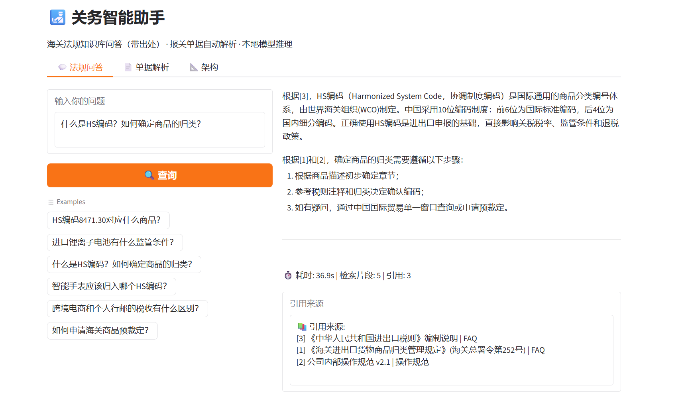
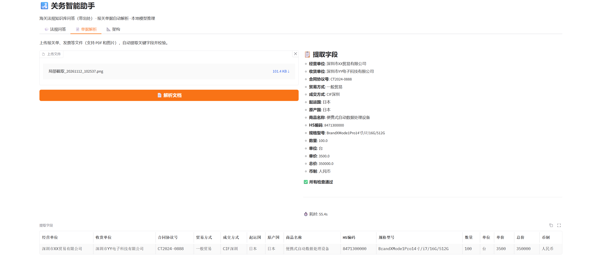

# CustomsAI · 关务智能助手

> 海关法规知识库问答（带出处） + 报关单据自动解析（PDF + 图片 OCR）。
> 基于 **Ollama (本地推理) + FAISS (向量检索) + RapidOCR (图片识别) + LangGraph (编排) + Gradio (界面)**。

## ✨ 核心功能

### 模块 A：带出处的知识库问答
- 支持关于 HS 编码、监管条件、归类规则的自然语言提问
- 回答强制标注来源（税则条款、归类决定编号等）
- 不编造法规依据，未找到时明确告知

### 模块 B：报关单据解析
- 支持 **PDF** 和 **图片**（拍照/扫描件）两种输入
- PDF → PyMuPDF 提取文字层
- 图片 → RapidOCR (PP-OCRv4 ONNX) 识别文字
- LLM 结构化提取关键字段
- HS 编码格式校验（6/8/10 位纯数字）
- 金额一致性检查（数量×单价 vs 总价）
- 必填字段完整性检查

## 🏗️ 系统架构

```
┌─────────────────────────────────────────────────────────────┐
│                      CustomsAI 关务智能助手                    │
├─────────────────────────────────────────────────────────────┤
│                                                               │
│  ┌──────────── 接入层 ────────────┐                          │
│  │  Gradio UI    FastAPI API      │                          │
│  └───────────────────┬───────────┘                          │
│                      │                                       │
│  ┌──────────── 编排层 (LangGraph) ────────────┐              │
│  │                                             │              │
│  │  知识问答工作流:                             │              │
│  │    retrieve → generate_answer → END         │              │
│  │                                             │              │
│  │  文档解析工作流:                             │              │
│  │    parse_document → extract_fields → END    │              │
│  │                                             │              │
│  └───────────────────┬─────────────────────────┘              │
│                      │                                        │
│  ┌──────────── 能力层 ────────────────────────┐              │
│  │                                             │              │
│  │  ┌──────────────────┐  ┌─────────────────┐ │              │
│  │  │ RAG 引擎          │  │ 文档解析引擎     │ │              │
│  │  │ · bge-small-zh   │  │ · PyMuPDF (PDF) │ │              │
│  │  │ · FAISS 向量检索  │  │ · RapidOCR (图片)│ │              │
│  │  │ · 引用溯源       │  │ · LLM 字段提取   │ │              │
│  │  └──────────────────┘  │ · 规则校验      │ │              │
│  │                        └─────────────────┘ │              │
│  │  ┌──────────────────────────────────────┐  │              │
│  │  │ LLM 引擎: Ollama + qwen2.5:7b        │  │              │
│  │  └──────────────────────────────────────┘  │              │
│  └─────────────────────────────────────────────┘              │
│                      │                                        │
│  ┌──────────── 数据层 ────────────────────────┐              │
│  │  FAISS 索引    JSONL 结构化数据    审计日志  │              │
│  └─────────────────────────────────────────────┘              │
│                                                               │
└─────────────────────────────────────────────────────────────┘
```

### 文档解析详细流程

```
上传文件 (PDF / JPG / PNG)
        │
        ├─ PDF → PyMuPDF 提取文字层
        │
        └─ 图片 → RapidOCR (PP-OCRv4 det + rec)
                    ↓
              原始文本
                    ↓
        LLM 结构化提取 (qwen2.5:7b)
                    ↓
              JSON 字段
                    ↓
        ┌─────────────────────────────┐
        │ 规则校验                     │
        │ · HS编码: 6/8/10位纯数字     │
        │ · 金额: 数量 × 单价 ≈ 总价   │
        │ · 必填: 经营单位/商品名称等   │
        └─────────────────────────────┘
                    ↓
              输出 + 告警
```

## 🚀 快速开始

```bash
# 1. 安装依赖
python -m venv .venv
.venv\Scripts\activate
pip install -r requirements.txt

# 2. 生成数据
python data/generate_data.py
python data/generate_pdfs.py   # 需要 pip install reportlab

# 3. 配置
copy .env.example .env

# 4. 启动（确保 Ollama 在运行）
python run.py
```

## 📁 目录结构

```
customs-ai/
├── app/
│   ├── api/main.py           # FastAPI
│   └── ui/gradio_app.py      # Gradio Web UI
├── customs_ai/
│   ├── config.py
│   ├── knowledge/            # 知识库（RAG）
│   │   ├── ingest.py         # 入库+向量化+FAISS
│   │   └── citation.py       # 引用溯源
│   ├── parser/               # 文档解析
│   │   ├── pdf_reader.py     # PyMuPDF (PDF)
│   │   ├── image_reader.py   # RapidOCR (图片)
│   │   └── field_mapper.py   # LLM提取+规则校验
│   └── pipeline/             # LangGraph 编排
│       ├── graph.py
│       ├── nodes.py
│       ├── state.py
│       └── observability.py
├── data/
│   ├── generate_data.py      # 数据生成脚本
│   ├── generate_pdfs.py      # PDF 生成脚本
│   └── processed/            # 结构化数据（自动生成）
├── requirements.txt
├── Dockerfile
├── DEPLOYMENT.md
├── run.py
└── README.md
```


## 🔧 技术选型说明

| 组件 | 选型 | 理由 |
|------|------|------|
| OCR | RapidOCR (PP-OCRv4 ONNX) | 中文效果好 |
| Embedding | bge-small-zh-v1.5 | 中文语义检索最优小模型 |
| 向量库 | FAISS | 轻量，无需额外服务 |
| LLM | Ollama + qwen2.5:7b | 本地离线，满足内网要求 |
| PDF | PyMuPDF | 快速提取文字和表格 |
| 编排 | LangGraph | 条件路由 + 可观测性 |

## 项目运行截图：
知识库问答



单据识别
